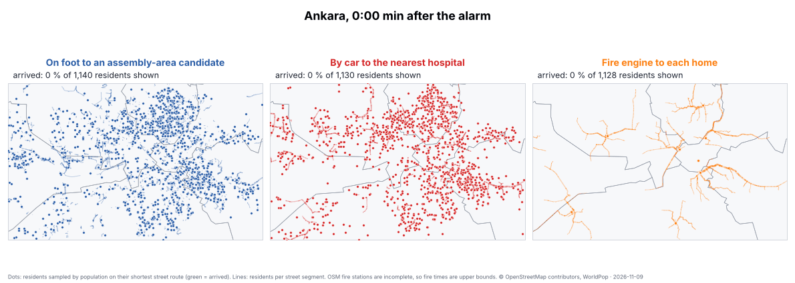
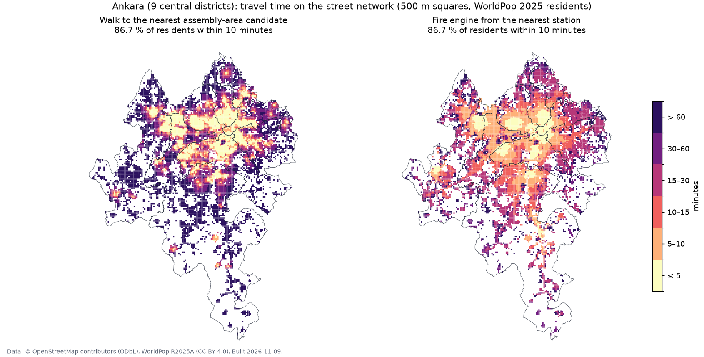

# opendata-disaster-ankara: how fast can people in Ankara reach safety and help in a disaster?

[](https://github.com/MustafaBugraBEKDEMiR/opendata-disaster-ankara/actions/workflows/ci.yml)
[](https://github.com/MustafaBugraBEKDEMiR/opendata-disaster-ankara/actions/workflows/build.yml)

When a disaster strikes (an earthquake, a large fire, a flood, an industrial accident), the first
minutes decide a lot. For every 100 m of populated land in Ankara's nine central districts, this project
computes, with **open data only**, how many minutes residents need to:

* **walk to the nearest open space that can serve as an assembly area** (park, school grounds or a mapped assembly point),
* **drive to the nearest hospital**, and
* **be reached by a fire engine** from the nearest fire station,

along the real street network. It ranks districts and neighbourhoods (*mahalle*) by how many of their
residents are within 5, 10 and 15 minutes, **simulates the routes** people would take, and finds the
**streets where an evacuation would crowd first**. It checks itself against the one official source that is
open: Kadıköy Municipality's list of assembly areas.

**Live map and simulation:** <https://mustafabugrabekdemir.github.io/opendata-disaster-ankara/> ·
**All numbers:** [`results/RESULTS.md`](results/RESULTS.md)



<sub>Each dot is a resident (sampled by population) following their shortest street route; it turns green on
arrival. Lines show how many residents' routes use each street segment. Generated from the data by
[`scripts/make_gif.py`](scripts/make_gif.py).</sub>



## Key findings (OSM extract of 9 November 2026)

5.32 million residents, 176,360 populated 100 m cells, 18,900 km of walkable streets.

| | ≤ 10 min | median |
|---|---|---|
| Walk to the nearest assembly-area candidate (park, school grounds, assembly point) | **86.7 %** of residents | 2.9 min |
| Drive to the nearest hospital | **94.8 %** | 2.6 min |
| Fire engine from the nearest station *(see the caveat below)* | **86.7 %** | 5.5 min |

1. **Ankara's assembly areas are practically absent from OpenStreetMap.** Only 14 points are tagged
   `emergency=assembly_point` in the nine districts; 96.5 % of residents have none within an hour's walk.
   Anyone building an app or a map on OSM for Ankara inherits that gap. Parks and school grounds are
   everywhere by comparison (2,285 parks ≥ 1,000 m², 1,116 schools).
2. **The urban edge is where walking access breaks down.** Gölbaşı has only 49.9 % of its residents within
   a 10-minute walk of a candidate (median 10 min), Sincan 73.6 %; Keçiören has 97.6 %. Among urban
   neighbourhoods (≥ 10,000 residents) the weakest are on the western and north-western edge: Bahçekapı
   (Etimesgut, 64,800 residents, 25.4 % within 10 min), Erler (Etimesgut, 17.8 %) and İvedikköy
   (Yenimahalle, 16.8 %). Two Sincan entries are organised industrial zones (OSB); WorldPop spreads
   population over all buildings, factories included, so read those with care.
3. **Fire-engine coverage is weakest in Pursaklar and Gölbaşı** (44.9 % and 54.3 % within 10 min), but see the
   caveat: OSM has 15 fire stations in the study area, while Ankara Fire Department reports about 49 stations
   province-wide. These times are therefore an upper bound.
4. **OSM candidates are a usable but generous stand-in for the official list.** In Kadıköy, where the
   official list is open, all 21 neighbourhoods matched: OSM yields 226 candidates and 1.66 million m²
   against 150 official areas and 1.16 million m² (43 % more surface). The neighbourhood ranking agrees
   moderately (Spearman 0.63). The surplus comes mostly from large coastal and district parks that the
   municipality does not count in full (Fenerbahçe: 180,000 m² in OSM vs 9,400 m² official).
5. **WorldPop is reliable at this scale.** Kadıköy: 487,500 (WorldPop 2025) vs 483,100 (official 2022), Spearman
   0.95 across neighbourhoods. Ankara districts: 1.02–1.08 × the TÜİK 2021 register, consistent with four years of growth.

Full tables, including every district and the 25 weakest neighbourhoods: [`results/RESULTS.md`](results/RESULTS.md).

## Why open data, and what that means

Türkiye's official assembly areas (*toplanma alanları*) are set by AFAD and the municipalities and can be
looked up one address at a time on e-Devlet, but they are not published as a downloadable dataset for
Ankara. Scraping a lookup service is not open data, so this project does not try. Instead it works with
**candidates**, the kinds of open space that assembly areas are usually chosen from:

| Layer | Source | Licence |
|---|---|---|
| Streets, footpaths, one-way rules, speed limits | OpenStreetMap ([Geofabrik](https://download.geofabrik.de/europe/turkey.html) Türkiye extract) | ODbL 1.0 |
| Parks, school grounds, assembly points, hospitals, fire stations | OpenStreetMap | ODbL 1.0 |
| Neighbourhood (*mahalle*) boundaries | OpenStreetMap, `admin_level=8` | ODbL 1.0 |
| Residents per 100 m cell | [WorldPop](https://hub.worldpop.org/) R2025A, 2025, constrained | CC BY 4.0 |
| District boundaries | geoBoundaries, via [turkiye-district-gis](https://github.com/MustafaBugraBEKDEMiR/turkiye-district-gis) | ODbL 1.0 |
| District populations (check) | TÜİK ADNKS 2021, via turkiye-district-gis | public statistics |
| Official assembly areas and population per neighbourhood (validation) | [Kadıköy Belediyesi Açık Veri](https://acikveri.kadikoy.bel.tr) | CC BY 3.0 |

The **validation** step asks the obvious question: *if the official list were open, how close would the
OpenStreetMap candidates be?* For Kadıköy, where it is open, the pipeline compares the official
number and surface of assembly areas per neighbourhood with what it derives from OSM, and the official
2022 population with WorldPop. See [the validation section of the results](results/RESULTS.md#validation-kadıköy-istanbul).

## Method

```
Geofabrik .osm.pbf ──osmium extract──▶ study area ──pyosmium──▶ road graph (split at junctions)
                                                  └─osmium export─▶ facilities, neighbourhoods
WorldPop 100 m GeoTIFF ──rasterio──▶ populated cells
                 │
                 ▼  PostgreSQL 16 · PostGIS 3.4 · pgRouting 3.6  (all logic in sql/)
  11 network      walking graph (undirected) and driving graph (one-way aware), largest components only
  12 places       facilities → entry nodes; each cell snapped to the closest point of the closest edge
  13 access       multi-source Dijkstra: one virtual node joined to every facility, one pgr_drivingDistance
  14 indicators   population-weighted shares within 5/10/15 min and medians, per area/district/mahalle
  20 validation   Kadıköy: official assembly areas vs OSM candidates, official population vs WorldPop
                 │
                 ▼  scripts/simulate.py (reads the shortest-path trees)
  street loads    residents per street segment, summed down each tree
  routes          full, time-stamped routes of 1,500 residents per scenario, drawn by population
                 │
                 ▼
  docs/data/ (web map + simulation) · results/RESULTS.md · docs/img/ (figure + GIF)
```

Details that matter for the numbers:

* **Cells join the network at the closest point of the closest edge**, not at the closest junction, and
  the part of the edge up to each end node is added. On long rural roads, snapping to junctions would
  add hundreds of metres.
* **Parks and school grounds are entered from every street node within 25 m of their outline**, so a large
  park is reachable from all sides rather than from its centroid.
* **Driving respects one-way streets in the right direction:** a fire engine leaves the station
  (station → home), a patient goes to hospital (home → hospital, routed on the reversed graph).
* **Routes come from the same computation as the times.** `pgr_drivingDistance` returns, for every node,
  the next node towards the nearest facility. Following those links gives each resident's full route,
  and summing residents down the tree gives the load of every street segment. No second routing step is
  needed, so the simulation and the indicators cannot disagree.
* **Nothing is dropped silently.** Residents with no road within 250 m, or not reached within 60 minutes,
  are reported as "not reached".

| Assumption | Value | Where |
|---|---|---|
| Walking speed in an evacuation | 4 km/h | `WALK_SPEED_KMH` |
| Driving speed | OSM `maxspeed`, else 30–100 km/h by road class; free flow, no damage | `DRIVE_SPEED_DEFAULT` |
| Smallest park counted | 1,000 m² | `MIN_PARK_M2` |
| Max. distance from a cell to a road | 250 m | `MAX_SNAP_M` |
| Routing cut-off | 60 min | `MAX_COST_S` |

All in [`scripts/config.py`](scripts/config.py); change a value and rerun to test the sensitivity.

## Simulation

The **Simulation** tab of the [live map](https://mustafabugrabekdemir.github.io/opendata-disaster-ankara/#sim)
plays three scenarios on the real street network:

| Scenario | Who moves | Route |
|---|---|---|
| Evacuation on foot | residents | home → nearest park, school ground or assembly point, at 4 km/h |
| To hospital | residents, by car | home → nearest hospital, one-way streets respected |
| Fire response | fire engines | nearest station → each home |

The 1,500 animated residents per scenario are drawn at random with probability proportional to population
(fixed seed, so every build draws the same people). The street-load lines underneath include **all**
residents. It is a route simulation, not a crowd model: people do not slow each other down, and roads
are assumed open. The load lines show where congestion *would* start.

## Run it

**Docker** (nothing else to install):

```bash
docker compose run --rm pipeline                 # tests on the built-in test grid (~1 min)
docker compose run --rm pipeline make all        # real data: download → prepare → build → export
```

**Without Docker:** PostgreSQL ≥ 14 with PostGIS ≥ 3.1 and pgRouting ≥ 3.4, `osmium-tool`, Python ≥ 3.10.

```bash
pip install -r requirements.txt
export PGHOST=localhost PGUSER=gis PGPASSWORD=gis PGDATABASE=access
python tests/run_tests.py     # test grid
make all                      # download (~0.7 GB), prepare, build, export
```

**On GitHub:** the [`build`](.github/workflows/build.yml) workflow (Actions tab → *Run workflow*) does
the same on a GitHub runner and commits the results; it also reruns monthly with fresh OSM data.

### Tests

[`tests/run_tests.py`](tests/run_tests.py) runs the real pipeline (osmium → Python → every SQL file) on a
hand-made 5 × 5 street grid whose answers can be checked on paper. It is a test fixture, not data. It checks
splitting at junctions, walk/drive permissions, one-way detours (a 6-block detour where the direct
way is 4 blocks), entry from all sides of a park, exact walking and driving times, that unrouted residents are
reported, the evacuation load on each street, the full time-stamped routes (a walker ends at the park,
a fire engine starts at the station), neighbourhood assignment, Turkish name matching and number parsing.

## Limitations

* **Candidates, not official assembly areas.** A park can be fenced, a school yard locked or too small;
  an official area may be a car park that OSM does not tag as open space. The Kadıköy check shows how
  large this gap is in one district; it does not prove the same for Ankara.
* **OpenStreetMap completeness varies.** Footpaths, school outlines and especially
  `emergency=assembly_point` are mapped unevenly; a gap on the map can be a gap in OSM. Fire stations are
  the clearest case: 15 in OSM for the study area, against about 49 stations that the Ankara Fire Department
  reports for the whole province.
* **Population in industrial zones.** WorldPop distributes people over buildings; organised industrial zones
  (OSB) can receive residents they do not have.
* **Free-flow driving.** No traffic, no debris, no collapsed buildings: post-disaster times will be longer.
  The driving results show the best case of the network's layout.
* **WorldPop is a model.** It distributes census totals to buildings; the TÜİK comparison in the results
  shows how close it is per district.
* **Neighbourhood boundaries** come from OSM and may not match the official MAKS boundaries everywhere.

## Repository layout

```
scripts/   config.py (all settings), download.py, prepare.py, build.py, simulate.py,
           export_web.py, make_figure.py, make_gif.py
sql/       00_init → 14_indicators (per area), 20_validation, 21_report
tests/     run_tests.py (test grid built in code)
docs/      index.html (Leaflet web map + simulation), data/ (exported by the build), img/
results/   RESULTS.md, SOURCES.json (URL, size, SHA-256 and date of every input file)
```

Related: [turkiye-district-gis](https://github.com/MustafaBugraBEKDEMiR/turkiye-district-gis) (national district
database this project takes its boundaries from) and [residenceinsys](https://github.com/MustafaBugraBEKDEMiR/residenceinsys)
(who lives in an affected area).

Code: MIT licence. Data: see the table above.

---

## Türkçe özet

Afet anında (deprem, büyük yangın, sel, endüstriyel kaza) ilk dakikalar belirleyicidir. Bu proje, Ankara'nın dokuz merkez ilçesinde (Altındağ, Çankaya, Etimesgut, Gölbaşı, Keçiören, Mamak,
Pursaklar, Sincan, Yenimahalle) her 100 m'lik nüfuslu alan için gerçek yol ağı üzerinden şu süreleri hesaplar:

* toplanma alanı olabilecek en yakın açık alana (park, okul bahçesi, haritalanmış toplanma noktası) **yürüme süresi**,
* en yakın **hastaneye araçla** ulaşım süresi,
* en yakın **itfaiye istasyonundan** araç çıkış süresi.

Sonuçlar ilçe ve mahalle bazında, nüfusun yüzde kaçının 5, 10 ve 15 dakika içinde ulaşabildiği şeklinde
özetlenir. Resmî AFAD toplanma alanları Ankara için açık veri olarak yayımlanmadığı için yalnızca
**açık veri** kullanılır (OpenStreetMap, WorldPop) ve bu alanlar "aday" olarak adlandırılır. Bu yaklaşımın
ne kadar isabetli olduğu, resmî verisini açık yayımlayan **Kadıköy** üzerinde test edilir.

**Simülasyon:** En kısa yol ağaçlarından her sakinin gerçek rotası çıkarılır. Web haritasındaki
*Simulation* sekmesi ve yukarıdaki GIF, nüfusa göre seçilmiş sakinlerin toplanma alanına yürüyüşünü,
hastaneye gidişini ve itfaiye araçlarının istasyondan evlere gelişini canlandırır. Her sokağın kaç kişinin
rotası üzerinde olduğu da hesaplanır; böylece tahliyede ilk sıkışacak caddeler görülür.

**Öne çıkan sonuçlar:** Nüfusun %86,7'si en yakın toplanma alanı adayına 10 dakikada yürüyebiliyor; en
zayıf ilçe Gölbaşı (%49,9). OpenStreetMap'te Ankara'nın resmî toplanma alanları neredeyse hiç yok (yalnızca
14 nokta). Kadıköy'de OSM adayları resmî listeden %43 daha fazla alan veriyor; mahalle sıralaması orta
düzeyde uyuşuyor (Spearman 0,63). WorldPop nüfusu ise resmî nüfusla neredeyse birebir örtüşüyor (%0,9 fark).

Kurulum: `docker compose run --rm pipeline make all`. Tüm analiz SQL'dedir (PostGIS + pgRouting).
Testler, sonuçları kâğıt üzerinde doğrulanabilen küçük bir test ızgarası üzerinde tüm hattı çalıştırır.

**Yazar / Author:** Mustafa Buğra Bekdemir: Geomatics Engineer, M.Sc. student in Management Information Systems (AYBÜ).
